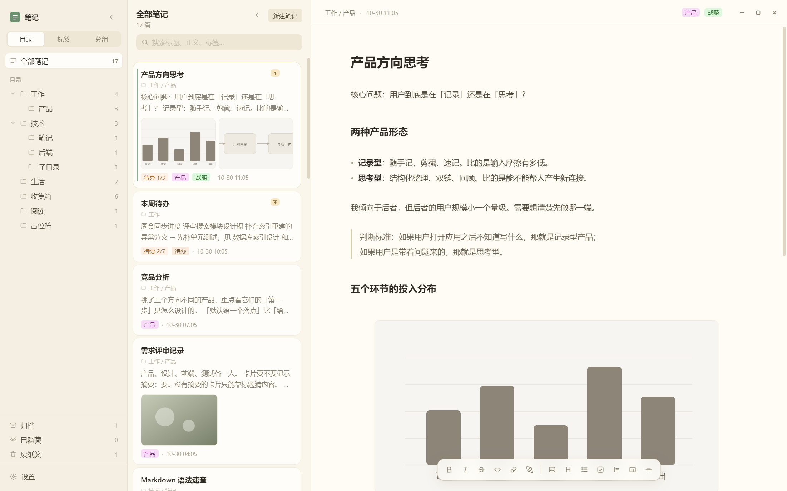
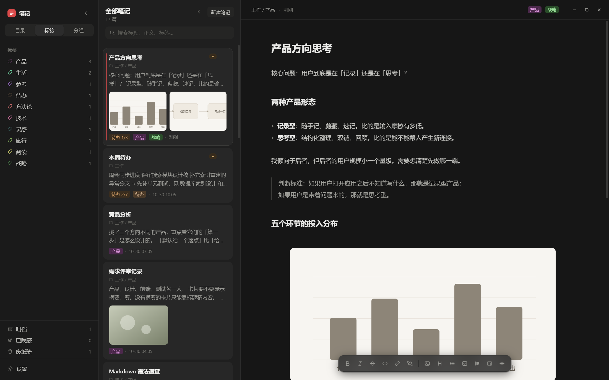
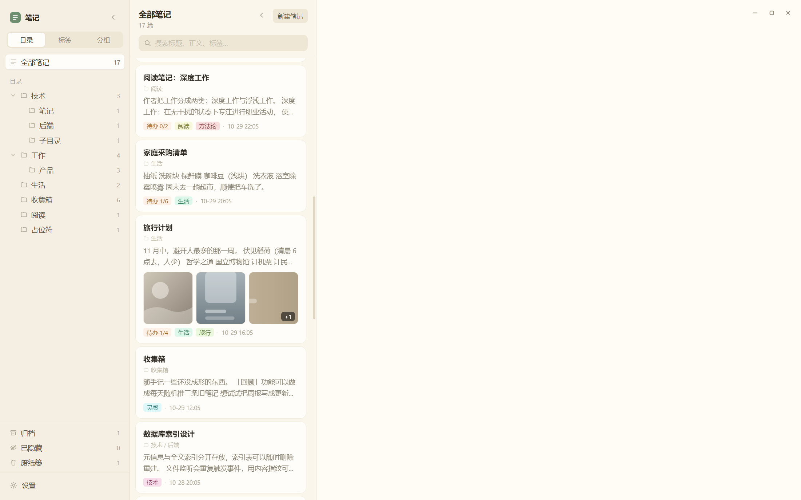

# 笔记 · 桌面版

[English](README.md) · **简体中文**

> **下载**：[v0.1.0 · Windows x64](https://github.com/JeffreyXXL/notes-app/releases/latest)
> —— 解压后双击 `Notes.exe`，不用装 Node、不用命令行、不联网。

三栏 Markdown 笔记应用。前端是 **Vite + TypeScript + CodeMirror 6**（无框架，手写原生 DOM），桌面外壳做了两套，共用同一份前端、同一套命令契约、同一个笔记库目录：

| 外壳 | 体积 | 编译要求 | 现状 |
| --- | --- | --- | --- |
| **Electron** | 打包后 278MB | 无，装完 npm 就能跑 | ✅ 已打包并验证可运行 |
| **Tauri 2** | 约 8MB | 需要 Rust + Windows 10/11 SDK | 源码完整，待编译 |

选 Electron 是因为它不需要编译器，装上依赖就能出窗口；Tauri 版留着，等机器上装了 Rust 随时切，笔记和设置完全通用。

界面：左栏分类（目录 / 标签 / 分组 + 归档 + 已隐藏 + 废纸篓）、中栏卡片列表（左滑操作 / 单击 `···` 唤出菜单 / 拖拽调顺序）、右栏整篇连续编辑并实时渲染 Markdown 与图片。

左上角的名字、色系、字体、密码锁定都能在设置里改；锁屏是一层盖在界面上的密码框，不是文件加密。

窗口是无边框的，系统标题栏已去掉，右上角的 `— □ ✕` 是自绘的（拖动窗口直接拖三栏顶部的空白处，双击顶部空白 = 最大化/还原）。



<sub>图是真实 Electron 窗口里截的（`npm run desktop:shots` 自动生成），不是浏览器预览。
库里的笔记是**虚构的演示数据**——产品方向、读书笔记、采购清单这类，一个真实项目名都没有。</sub>

再放两张（暗色、卡片多图）：





---

## 0. 怎么用

### 最快：双击已经打好的 exe

```
dist-app\Notes-win32-x64\Notes.exe
```

就这样，没有别的步骤。不需要 Node、不需要命令行、不联网、不弹浏览器。

### 直接跑起来（不用装任何编译器）

```powershell
# 路径里有空格的话，必须加引号
cd notes-app
npm install
npm run desktop
```

会打开一个独立窗口，没有地址栏、没有浏览器外壳。首次启动会在 `%APPDATA%\com.notesapp.desktop\vault` 写入 10 篇示例笔记。

### 打包成可以双击的 exe

```bash
npm run desktop:pack
```

产物在 `dist-app\Notes-win32-x64\Notes.exe`（实测 278MB，其中 Electron 运行时本身 181MB、你的代码和字体 10.4MB）。
双击即用，不依赖 Node、不联网、不起端口。整个 `Notes-win32-x64` 文件夹可以整体拷到别的 Windows 机器上直接用。

> 如果打包时旧版 `Notes.exe` 还开着，脚本不会去覆盖（会写坏文件），
> 而是自动输出到 `dist-app-2\`，并在控制台说明。关掉旧窗口后重新打包就会回到 `dist-app\`。

> 想放到桌面：右键 `Notes.exe` → 发送到 → 桌面快捷方式。
> 别只拷 `Notes.exe` 一个文件，它旁边那些 `.dll` 和 `resources\` 是运行必需的。

### 开发调试（浏览器热更新，改代码最快）

```bash
npm run dev
```

浏览器打开 `http://localhost:1420`。数据存在 localStorage，功能完整，只是不落真实文件。

> `1420` 是 **Vite 开发服务器**（只监听本机，用来提供页面 + 热更新），不是后端服务。
> `npm run desktop` 打包后完全不需要它：前端资源被编进 asar，Electron 通过自定义协议 `app://` 从本地读，
> 不联网、不起端口、没有数据库进程。

### 自检

```bash
npm run test:io        # 12 个文件读写单元测试（路径穿越、原子写、空目录回收、图片落盘…）
npm run desktop:smoke  # 无头启动真实窗口，检查 DOM / 桥接 / 落盘，并截图
npm run desktop:shots  # 同上，但笔记库换成虚构的演示数据，专门用来生成 README 的图
```

> **截图用的是演示库，不是你的笔记。** `--demo` 会把笔记库指到临时目录里一套
> 现编的笔记（产品方向、读书笔记、采购清单、旅行计划…），一个真实项目名、
> 客户名都没有。以前截图是复制用户真实库跑出来的，左栏全是客户目录、
> 卡片里是现场照片——那种图一旦跟着仓库发出去就等于泄露，所以彻底换掉了。

`desktop:smoke` 会真的点一遍再退出：真鼠标点设置面板的关闭按钮和右栏开关 → 点卡片 → 截图 → 单击表格进编辑 → 点别处变回表格 → 点快捷栏粗体再撤销 → 单击 `···` 展开操作条 → 切三套色系 × 明暗各截一张图 → 标签多选 → 目录重命名（改完再改回来）→ 置顶标志 → 拖拽排序（拖完再拖回来）→ 图片渲染 → 单击只选中 → 点 50% 预设 → 拖把手加宽 → 缩到 25% → 双击进源码 → 粘贴落盘 → 卡片预览（无空白卡 + 缩略图 + CRLF 摘要）→ 代码块高亮 + 单击不动 + 双击进源码 → 点站内链接跳转 → 待办解决方式 → 卡片目录路径逐级变短 → 左栏目录拖拽排序 → 目录改名后旧目录被收走 → 改标题后文件改名 → 启动时把「无标题」这类占位符文件名对齐成标题 → 右键隐藏 / 已隐藏里取消隐藏 → 改应用名 → 卡片图独占一行 + 多图并排 → 设密码 / 锁定 / 错密码被挡 / 对密码放行。截图落在 `docs/`：

| 文件 | 内容 |
| --- | --- |
| `scheme-{cream,graphite,paper}-{light,dark}.png` | 6 种配色组合各一张 |
| `settings-appearance.png` | 设置里的「名字 / 色系 / 明暗 / 安全」 |
| `meta-tags.png` | 「整理」弹层里的标签多选 |
| `left-rename.png` | 左栏目录的就地重命名输入框 |
| `desktop-image.png` | 正文里的图片（整窗） |
| `image-resize.png` | 图片选中态：描边 + 尺寸工具条 + 拖拽把手 |
| `code-block.png` | 代码块：语言标签 + 语法高亮 + 复制按钮 |
| `note-links.png` | 站内链接 + 待办的「→ 解决方式」 |
| `card-multi.png` | 卡片预览里的多图并排（三张不同比例的图均分一行） |
| `lock-screen.png` | 密码锁屏 |
| `desktop-window.png` / `tag-colors.png` | 默认界面 / 标签配色 |

> `zoom-*.png`（放大细节图）走 `capturePage` 裁区域，会写到系统临时目录而不是 `docs/`。

几个断言值得留着：

| 输出 | 含义 |
| --- | --- |
| `blank=… drag=none` | 占位元素不能是窗口拖动区 |
| `window=1570x960` | 默认窗口尺寸（小屏幕会按比例收） |
| `setClose … openAfter=0` / `setSwitch … before=true after=false` | 设置面板右半边和开关真的能点动 |
| `tagEditor=8->10` | 标签能连着加两个 |
| `rename=技术 -> 技术-改` + `renameBack=技术` | 目录改名真的搬了文件，且能改回来 |
| `pinFlag=flags1 cards1 firstPinned=1` | 有置顶笔记就有标志，且排在最前 |
| `orderDrag=changed` + `orderBack=restored` | 拖拽排序生效且可逆 |
| `img=1/1/600x220 broken=0` | 图片真的解码出像素（600×220 是测试 SVG 自带尺寸） |
| `imgPick=1/0 selected=1 tools=1 grip=1` | **单击只选中**：图还在（1）、没退成源码（0）、工具条和把手都出来了 |
| `imgBox={"tools":1368,"frame":1376}` | 工具条贴着图片右边 8px，没飘到整列右边；`overflow:0` 说明按钮没撑破工具条 |
| `imgHalf={"w":365,"box":730}` | 点 50% 预设，宽度正好是正文宽的一半 |
| `imgDrag={"before":365,"after":465}` | 拖把手加宽 100px，松手后宽度真的变了 |
| `imgNarrow={"fw":183,"tw":263,"over":40}` | 图比工具条还窄时，工具条居中溢出（40 = (263−183)/2） |
| `imgResize={half,drag,mdHalf,mdDrag,narrow}` | 预设 / 拖拽 / 百分比 / 像素，都写进了磁盘上的 `.md` |
| `preview=cards4 blank0 thumbs1` | 卡片预览：没有空白卡，至少一张缩略图 |
| `crlf="这一行是正文…"` | CRLF 写的笔记摘要也能提取出来（这条守住过一个真 bug） |
| `imgEdit=0/1` | **双击**图片才退回源码行 |
| `imgPasteFile=… size=70` | 粘贴的图真的落到了磁盘上 |
| `tagTints=8/8` / `grip=open1 close0` | 标签配色不撞 / `···` 单击展开收起 |
| `code={"blocks":2,"lang":"ts","kw":3,"str":1,"com":1,"fn":1,"tables":0}` | 两个代码块都渲染出来，语言标签对，关键字 / 字符串 / 注释 / 函数名都染上色；**代码里的表格没被当成表格** |
| `codeClick=2/0` | **单击代码块什么都不发生**：两个块都还在、一行围栏都没露 |
| `codeEdit=1/2` | 双击才退回源码（少一个块、多两行围栏） |
| `link={"wiki":2,"note":1,"add":1}` | 两个站内链接 / 一条待办解决方式 / 一个「＋」 |
| `linkJump="图片测试"` | 点 `[[图片测试]]` 真的跳到那篇（看的是中栏的选中卡片） |
| `cardPath all="技术 / 子目录" lv1="子目录" lv2=""` | 卡片路径逐级变短，到没有下级就整行不显示 |
| `leftOrder=技术,收集箱 -> 收集箱,技术 saved=["收集箱",…]` | 目录拖拽换位，而且顺序写进了设置文件 |
| `prune oldGone=true newThere=true` | 改名后旧目录（含里面的空子目录）真的被收走 |
| `titleRename title="代Z码块测试" hasZ=true oldGone=true` | 改 H1 之后文件真的改名了，旧文件名不在了 |
| `placeholderRename old=false new=true` | 启动时把「占位符/无标题.md」按正文标题改成了「占位符改名测试.md」 |
| `hide={"hasRow":true,"hideBefore":17,"hideAfter":16,"hiddenCnt":"1","inHidden":1,"hiddenAfter":"0"}` | 右键菜单有「隐藏」；藏完列表少一条、左栏计数 +1；「已隐藏」里找得到同一篇；取消隐藏后计数归零 |
| `appName brand="我的笔记" docTitle="我的笔记"` | 改名后左上角和窗口标题一起变 |
| `thumbRow={"disp":"block","w":139,"cardW":313,"below":8}` | 卡片图是 block、在摘要下面另起一行 |
| `thumbUniform sameH=true h=[96] fitOk=true modes=multi:2,solo:1,multi:2,solo:1,multi:3,multi:2` | **所有卡片缩略图高度一致**；单图 `contain` 不裁，多图 `cover` 且同一张卡片里宽度一致 |
| `figs=[{"total":2,"shown":2,…,"gap":6},…,{"total":4,"shown":3,"more":"+1"}]` | 两张以上的卡片都真的并排显示了；一排最多露 3 张、间距 6px、不溢出卡片，第 4 张起收进 `+N` |
| `lock={"enabled":true,"shown":true,"stillLocked":true,"errText":"密码不对","unlocked":true}` | 设完密码开关变开；「立即锁定」真的盖上；错密码被挡住并提示；对密码放行 |
| `railRegion=no-drag coveredBy=""` | 折叠后浮出的恢复按钮已经从窗口拖动区里挖出来了 —— 否则真实鼠标点它只会拖窗口，点不到按钮 |

最后一行 `verdict={...}` 把上面这些布尔值全打出来，哪一项红了直接看名字。

> 冒烟模式是**完全隔离**的，不会写脏你的真实笔记：
> - 笔记库：启动时把 `appData/vault` 整份 `cpSync` 到 `temp/notes-smoke-vault`，
>   所有写操作都落在副本上（`vaultRoot()` 里的 `smokeVault()`）
> - 设置文件：重定向到 `temp/notes-smoke-settings.json`
>
> 想跑在别的目录上，`NOTES_APP_VAULT` 优先于上面两条。
>
> 这一条是踩出来的：早期冒烟直接跑在真实库上，它挑真实笔记来点、来拖、来改标题，
> 一跑就把用户正在写的笔记 `mtime` / `updated` 刷掉。现在复制一份过去，
> 断言照样对着同样的数据跑，用户那边一个字节都不动。

### 日常怎么操作

**写笔记**
- 中栏右上角「新建笔记」按钮（或 `Ctrl/Cmd + N`），直接开始写。标题就是正文第一行 `# 标题`。
- 输入 `# `、`- `、`- [ ] `、`> `、`**粗体**`、`` `代码` `` 会立刻渲染成对应样式。
- 光标停在某一行时，那一行会露出 Markdown 源码方便改；移开又变回渲染态。
- 想关掉这个行为：设置 → 编辑器 → 关掉开关。

**底部快捷栏**
- 编辑区底部常驻一条悬浮工具栏，不用记语法也能排版。它是浮在正文上的，不占版面（正文底部本来就留了空档）。
- 左边一组是行内格式：粗体 / 斜体 / 删除线 / 行内代码 / 链接。
- 右边一组是块级元素：图片 / 标题 / 列表 / 待办 / 引用 / 表格 / 分隔线。
- 有选中文字时套在选中内容上；再点一次同一个按钮就取消。没选中时会插入一对标记，光标停在中间。
- 标题按钮是循环的：正文 → `##` → `###` → 正文。
- 表格按钮插入一个两列三行的模板，可以直接改。

**图片**
- 三个入口：快捷栏的图片按钮（打开文件选择框，可多选）、`Ctrl/Cmd + V` 粘贴截图、把图片文件直接拖进正文。
- 图片存进笔记库根目录的 `_assets/`，文件名是「时间戳 + 随机串」，不会撞车。
- 正文里写的是**库内绝对路径**：``。
  笔记在目录之间搬来搬去都不会失效——这也是不用相对路径的原因。
- 图片必须**单独占一行**才会渲染成图；夹在句子中间的保持 Markdown 源码。
- **单击图片只是选中**，不会跳成文字。选中后图片外面出现一圈描边，右上角浮出尺寸工具条，
  右下角出现拖拽把手。点别处就取消选中。
- **双击图片**才会把光标放进去、变回 `` 源码，用来改路径或 alt。
  工具条最右边那个「编辑」也是同一个作用。
- 文件被删了或路径写错，会显示一行「找不到图片：xxx」的提示，不是一个破图标。
- 也支持你手写的相对路径（`./img.png`），会先按「笔记所在目录」找，找不到再按库根找。

**改图片大小**
- 选中图片后，右上角工具条上有 `25% / 50% / 75% / 100%` 四个预设，百分比是**相对正文宽度**算的，
  窗口变窄图会跟着缩，不会溢出。点「原始」回到图片自己的像素尺寸。
- 或者直接**拖右下角那个斜纹小方块**，想多宽拖多宽。拖动时只改样式，松手才写文件，
  所以拖起来是跟手的，不会一卡一卡。
- 宽度写在 Markdown 行尾的大括号里：

  ```markdown
  {width=320}
  {width=50%}
  ```

  这是纯文本，别的 Markdown 编辑器里会当成一行多余的字显示（不影响图片本身）。
  大括号里的其它属性（`height` 之类）会原样保留，只改 `width`。
- 拖动出来的宽度写的是像素，预设写的是百分比。两者可以混用，下次打开都认得。

**表格**
- 标准 Markdown 表格会渲染成真表格：整表一个圆角外框，表头浅底，行与行、列与列之间各一根极淡的分隔线，没有斑马纹。
- 对齐语法生效：`:---` 靠左、`:---:` 居中、`---:` 靠右。
- 单元格里支持 `` `代码` ``、**粗体**、*斜体*、~~删除线~~、链接。
- **单击表格**会把光标放进去，整块变回 Markdown 源码，改完点别处又变回表格。
- 表格里的文字可以直接拖选复制（拖动不会触发编辑）。

**代码块**
- 围栏代码块（```` ```ts ```` / `~~~`）会渲染成一整块：顶上一个小标签写着语言，右上角一个「复制」按钮（鼠标移上去才出现）。
- **会按语言高亮**：注释、字符串、数字、关键字、类型、函数名、标点各一种颜色。
  认识 `js/ts/jsx`、`json`、`py`、`sh/bash`、`html/xml`、`css/scss`、`sql`、`go`、`rust`、`java/c/c++/c#`、`yaml`、`toml`，
  别名也认（`typescript`、`python`、`bash`、`rs`、`c++`……）。认不出的语言就原样显示，不报错。
- 高亮的颜色走 CSS 变量（`--hl-kw` / `--hl-str` / …），所以换色系、切明暗都不用重算。
- **双击代码块**把光标放进去，整块变回源码，改完点别处又变回渲染态——和图片是同一套交互。
  **单击什么都不做**：早先单击就散成源码，想滚一下、想挑个词复制、或者只是点偏了都得再点回去；
  鼠标移上去会提示「双击编辑」。
- 代码块里的 `| a | b |` 不会被误认成表格，`` 也不会被当成图片（整块是代码，里面的东西都不参与解析）。
- 以前是「把两行围栏藏起来、中间每行加个底色」的做法，拖选跨过代码块时被隐藏的围栏仍参与选区计算，
  选区会画在空白处，看着像错位；现在整块是一个 widget，这个问题没有了。

**链接到另一篇笔记**
- 两种写法都认，点一下就跳过去：

  ```markdown
  见 [[产品方向思考]]                     ← 按标题找，最省事
  见 [上次的结论](工作/产品/方向.md)        ← 按路径找，最精确
  ```

- `[[标题]]` 是逐级匹配的：相对当前笔记目录 → 库内路径 → 同名文件 → 同名标题 → 标题包含（只认唯一结果）。
  所以笔记改名之后，`[[旧标题]]` 仍然能找到它。
- `[文字](路径.md)` 里的路径可以是相对的（`./a.md`、`../x/a.md`）也可以是库内路径。
- `[文字](https://…)` 这种外链会用系统浏览器打开，不会在应用里新开窗口。
- 跳过去之后如果那篇在别的目录 / 归档 / 废纸篓里，会自动退回到能看见它的视图，不会「点开了却找不到」。
- 找不到会弹一行轻提示（「没有找到「xxx」这篇笔记」），不是默默没反应。
- 快捷栏里有两个链接按钮：一个插外链 `[文字](url)`，一个插站内链接 `[[笔记名]]`。
- 想编辑链接文字：点这一行别的位置把光标放进去（整行会变回源码），或者用方向键移过去。

**待办的解决方式**
- 每条待办后面可以跟一段「怎么解决」，写在箭头后面：

  ```markdown
  - [ ] 登录偶发失败 → 换掉旧的 token 校验，见 [[登录改造]]
  - [x] 导出太慢 → 改成流式写，参考 https://example.com/stream
  ```

- 渲染出来箭头是淡色的，解决方式是浅灰小字，和待办正文分得开；里面可以放 `[[笔记]]` 链接，一样能点。
- 勾掉这条待办时，删除线只划到箭头为止——解决方式不算「待办本身」。
- 还没写解决方式的待办，行尾有一个淡色的「＋」：鼠标移到这一行才出现，点一下就补上 `→ ` 并把光标停在后面。
- 也接受 `->` 这种写法，不用非得打全角箭头。

**卡片预览**
- 中栏每张卡显示「一段摘要 + 正文里的缩略图」，摘要最多两行，超出截断。
- 摘要**不是**简单取第一行：它会跳过标题（标题已经显示在卡片上方了）、跳过表格的 `| --- |` 分隔行、
  跳过代码块的 ``` 围栏、跳过单独占行的图片，然后按段落顺序往下取，凑够字数就停。
- 正文里**没有普通段落**时逐级降级，不会空着：
  表格 → 取第一行数据（`产品 · 需求与方向 · 自动分配`）；代码块 → 取第一行代码；只有图 → 只显示缩略图。
- 缩略图**另起一行**、**高度固定 96px**，一列卡片扫下来图都一样高。分两种情况：
  - **只有一张图**：宽度按图片自己的比例走（上限是卡片宽度），不裁、不留空框。
  - **两张以上**：均分一行并排摆开，最多露 **3 张**，超出的收进右下角的 `+N`。
    多图都裁成同一块（`object-fit: cover`），所以同一张卡片里的图永远一样大 ——
    笔记里的图比例从 1:1 到 3:1 都有，各按各的比例排会出现「一张占满整行、后面全被挤掉」。
  - 整篇只有图没有文字时，缩略图顶到最上面，不留一段空白。
  - 早期是 54×54 的方形小图贴在右边，长摘要会被挤成很窄的一条；
    后来一度改成「100% 宽 + 96 高 + `object-fit: cover`」，结果接近方形的截图
    被裁掉三分之二、看着像放大了一块，宽图却几乎完整，一列下来像是「每张图大小都不一样」。
    单图改成只固定高度、多图均分一行，是这两轮踩坑之后的结果。
- 代码块里的 `` 不算图（先按行扫掉围栏块再取图），同一张图重复引用只算一次。
- 图片被删了或路径写错，缩略图直接消失，卡片上不会留一个破图标；一排图全挂了整排撤掉。
- 真的一行字一张图都没有，卡片上写「空白笔记」，让你知道是空的而不是没渲染出来。
- 标题下面还有一行**目录路径**，显示的是「还没钻到的那几层」：

| 当前选中 | 卡片上显示 |
| --- | --- |
| 全部笔记 | 完整路径 `技术 / 前端 / React` |
| 一级目录 `技术` | `前端 / React` |
| 二级目录 `技术/前端` | `React` |
| 笔记就在这一层（下面没有更深了） | 整行不显示 |

  所以越往下钻这一行越短，最后自然消失，不会出现「技术 / 技术 / 技术」这种废话。

**调整顺序**
- 中栏列表**不跟随编辑时间自动重排**。写东西不会让卡片乱跳。
- 想换位置就**按住卡片上下拖**：会出现一根蓝色插入线，松手落位。顺序会写进 front matter 的 `order`，重启后还在。
- 置顶的笔记永远在最上面一组，拖不出这个分组。
- 新建的笔记排在最前面。
- 拖拽和左滑是同一套指针手势：**竖向意图**（上下移动）是调顺序，**横向意图**（左右移动）是左滑操作条。

**左栏目录 / 标签也能排序**
- 按住目录行上下拖就能换位置，会出现一根插入线标出落点。**只能在同级之间换位**（跨级拖会让目录树结构变得莫名其妙）。
- 顺序存在设置文件的 `folderOrder` 里（一个路径数组），重启后还在。
- 没排过的新目录自动排到末尾，按名字排，不用回头补序号。
- 标签列表同理（`tagOrder`），默认按「用得多的在前」，拖一次之后就按你的顺序来。
- 拖动时铅笔、展开箭头不参与拖拽；拖完不会顺手切换筛选。

**待办**
- 写 `- [ ] 事情` 会变成复选框，点一下打勾，后面的文字自动加删除线。
- 勾选状态直接写回文件（`- [x] 事情`）。
- 每条后面可以跟 `→ 解决方式`，详见上面「待办的解决方式」。

**找东西**
- `Ctrl/Cmd + K` 聚焦搜索框，输入即搜。标题、正文、标签、目录都参与匹配，标题命中优先。
- 搜索词在卡片和右侧正文里同时高亮，正文自动滚到第一处命中。
- 右上角显示「N 处匹配」；没有命中就不显示徽标。

**整理**
- 卡片左滑（鼠标拖也行）露出操作条：置顶 / 归档 / 整理 / 隐藏 / 删除。
- 桌面端更顺手：**单击卡片右上角的 `···`** 展开操作条（再点一次收起），或者**右键卡片**弹菜单。
- 「整理」里可以改目录和标签。改目录会真的移动文件到对应文件夹。
- **标签是多选的**：已选的显示成彩色 chips（点 `×` 删掉），下面是已有标签的淡色 chips，点一下就加，可以连着点。
  输入框里打新标签、回车也能加（不要求标签已存在）。输入框空着按退格删掉最后一个。
- 操作条显示哪几个按钮，在设置 → 交互 → 左滑显示的操作里勾选（至少留一个）。

**隐藏**
- 右键笔记 →「隐藏这篇笔记」，或者左滑 / `···` 里的「隐藏」。
- 隐藏之后：不进任何列表、不进搜索、**也不计入左栏目录和标签的数量**——就是彻底看不见了。
- 找回来的入口在左栏底部：**「已隐藏」**，和「归档」「废纸篓」并排，后面跟着数量。
- 在「已隐藏」里点「取消隐藏」就回到原来的目录，什么都没变。
- 和「归档」的区别是语义：归档是「这件事做完了」，隐藏是「我现在不想看见它」。两者互不影响。
- 状态写在 front matter 的 `hidden: true`。**只有隐藏了才写这一行**，没隐藏的笔记文件不会多出一行。
- 隐藏会把置顶一起取消——不然它在「已隐藏」里还排在第一个，有点怪。

**密码锁定**
- 设置 → 安全 → 「密码锁定」开关。第一次打开会弹窗让你设密码（至少 4 位，输两遍）。
- 打开之后**每次启动都要输密码**才能进。也可以点「立即锁定」手动锁。
- 密码输错会抖一下并提示「密码不对」，不会告诉你哪里错了。
- 改密码：设置 → 安全 → 「设置密码」。
- 忘记密码：关掉应用，用记事本打开设置文件，把 `lockHash` 改成空字符串、`lockEnabled` 改成 `false`。
  设置文件位置见设置面板最下面的「笔记库位置」旁边——同级的 `settings.json`。
- **这是一把挡人的锁，不是加密。** 笔记本身还是磁盘上的明文 `.md`，
  能直接拿到文件的人绕得过去。它的用途是「离开工位时别让人随手翻」。
- 密码只存摘要不存明文，摘要带算法前缀（`s1:` = SHA-256，`f1:` = 环境不支持 WebCrypto 时的退化算法）。

**改左上角的名字**
- 设置 → 外观 → 「名字」，改完立刻生效，窗口标题也跟着变。
- 最多 12 个字，太长会省略显示，不会把右边的收起按钮挤跑。
- 清空等于没改，会回到默认的「笔记」。

**改目录名**
- 鼠标移到左栏某个目录上，行尾会出现一支铅笔，点它就地改名，回车确认、Esc 取消。
- 改名会**真的把磁盘上的文件夹改掉**，底下所有笔记（含子目录）的文件一起搬过去。
- 搬完**旧目录会被收走**：连里面残留的空子目录一起删（只删空目录，还有文件就停手）。
  以前这里会留下一个空壳，看起来像「改名没成功」。
- 改名后同步更新：内存里的路径、当前选中的笔记、目录展开状态、正在筛选的那个目录。
- 目标目录已存在时自动加序号（`技术 2`），不会和已有目录混在一起。
- 为什么是铅笔按钮而不是双击行：点一下目录行就会切换筛选并重绘整棵树，行元素被换掉了，第二次点击落在新元素上，`dblclick` 永远不会触发。

**改标签名**
- 标签行上也有同一支铅笔，点它就地改名。
- 改名会**把所有笔记里的这个标签一起改掉**（去重后写回各自的 front matter），
  标签顺序表、正在按这个标签筛选的视图也跟着换。
- 改标签不会动文件，只改 front matter 里的 `tags`。

**标题改了，文件名跟着改**
- 正文第一个 `# 标题` 改动之后（停手约 1.4 秒），文件名会同步改成一样的。
  这是纯文本笔记最自然的样子：文件列表里看到的名字就是标题。
- 没有 `# 标题` 的笔记不会触发（此时标题就是文件名），所以不会出现「改名改回去」的死循环。
- 改名时会顺手把**别的笔记里指向它的链接**改掉：`[[旧标题]]` → `[[新标题]]`，
  `(旧路径.md)` → `(新路径.md)`。
- 文件名清洗规则和新建笔记一样（Windows 非法字符、保留名）。
- **启动时还会补一次历史账**：文件名还是「无标题」「无标题 3」「未命名」「untitled」这种占位符的，
  一开应用就按正文的 `# 标题` 改过来。
  这个功能上线之前建的笔记，正文写着 `# 智能工厂`、文件名却一直挂着「无标题 8.md」，
  在资源管理器里根本认不出哪篇是哪篇；而「改正文才触发改名」对老笔记永远不会生效。
  只动占位符 —— 你自己起过名字的文件一个都不碰，免得「一开应用满库文件被改名」。
- 不想要这个行为：设置 → 编辑器 → 关掉「标题改了，文件名跟着改」（关掉后启动时的对齐也一起停）。

**标签颜色**
- 颜色全自动分配，不用自己挑。同一个标签永远是同一个颜色。
- 同一批标签之间会尽量挑差异大的色相，不会出现两个标签撞成一样的颜色。
- 左栏标签列表的图标、中栏卡片上的标签、右栏标题栏的标签，三处颜色一致。
- 亮色主题是淡色底 + 深色字，暗色主题是深色底 + 浅色字，都跟着主题走。

**归档 / 已隐藏 / 废纸篓**
- 左栏底部固定三个入口，不随 tab 切换。
- 删除先进废纸篓（文件还在，只是标记 `trashed: true`），在废纸篓里可以恢复或彻底删除。
- 废纸篓的「清空」是两步确认：点一次变红色「确认清空」，3 秒内再点才真删。
- 「已隐藏」见上面「隐藏」那一节。

**分栏 / 外观**
- 左栏和中栏各自可折叠，点标题栏的 `‹`；折叠状态会记住。
- 窗口默认 **1570×960**（三栏铺开刚好的那个大小）。屏幕小的话按可用区域的比例自动收
  （1366×768 的笔记本上是 1175×655），不会顶出屏幕外面去。
- 色系三选一，明暗三选一，两个维度独立组合，一共 6 套：

| 色系 | 亮色 | 暗色 |
| --- | --- | --- |
| 奶油 | 暖米底 + 鼠尾草绿，卡片浮在米色上 | 深咖啡底，暖而不刺眼 |
| 石墨 | 深色侧边栏 + 近白正文 + 朱红点缀 | 近黑侧边 + 深灰正文 |
| 纸白 | 中性白，最素的阅读环境 | 中性暗灰 |

- 正文字体三选一（系统默认 / 霞鹜文楷 / Inter + 思源黑），字号行距各三档。
- 色系只换颜色，不动排版；想改颜色只需要动 `src/styles/tokens.css` 一个文件。

**快捷键**

| 按键 | 作用 |
| --- | --- |
| `Ctrl/Cmd + K` | 搜索 |
| `Ctrl/Cmd + N` | 新建笔记 |
| `Ctrl/Cmd + B` | 粗体 |
| `Ctrl/Cmd + I` | 斜体 |
| `Ctrl/Cmd + S` | 立刻保存（平时 450ms 自动保存） |
| `Esc` | 关弹层 / 清搜索 / 收起左滑条 |

---

## 1. 目录结构

```
notes-app/
├── index.html                 三栏静态骨架
├── vite.config.ts
├── app-icon.png               图标源图（1024）
├── src/                       ← 前端，两个外壳共用
│   ├── main.ts                启动 + 全局事件
│   ├── types.ts               Note / Settings / Filter 类型
│   ├── store.ts               状态与业务逻辑（唯一可变数据源）
│   ├── bus.ts                 事件总线，store 改完通知 UI
│   ├── settings.ts            默认设置 + 字体清单
│   ├── seed.ts                首次启动写入的示例笔记
│   ├── icons.ts               内联 SVG
│   ├── core/                  纯函数，零平台依赖
│   │   ├── text.ts            转义 / 摘要 / 待办统计
│   │   ├── fuzzy.ts           模糊搜索打分
│   │   ├── frontmatter.ts     front matter 读写
│   │   ├── tag-color.ts       标签自动配色（全局唯一分配）
│   │   ├── image.ts           图片路径约定 / 资源 URL 解析
│   │   ├── path.ts            路径拼接 / 文件名清洗
│   │   ├── open.ts            外链交给系统浏览器
│   │   └── time.ts            时间格式化
│   ├── storage/               ★ 平台适配层
│   │   ├── adapter.ts         StorageAdapter 接口
│   │   ├── ipc.ts             命令通道（Electron / Tauri 二选一）
│   │   ├── desktop.ts         桌面端：走 IPC 读写真实文件
│   │   ├── browser.ts         浏览器：localStorage
│   │   └── index.ts           运行时自动选择
│   ├── editor/
│   │   ├── live-preview.ts    CodeMirror 装饰层（Live Preview 核心：表格 / 图片 / 代码块 / 链接 / 行内标记）
│   │   ├── highlight.ts       代码高亮的词法着色（自带，不引 prism / shiki）
│   │   ├── commands.ts        Markdown 编辑命令（快捷栏和快捷键共用）
│   │   ├── image-insert.ts    图片落盘 + 插入（快捷栏 / 粘贴 / 拖拽共用）
│   │   └── index.ts           mount / setReveal / setSearch / 粘贴拖拽拦截
│   ├── ui/                    左栏 / 中栏 / 右栏 / 弹层 / 主题
│   │   ├── quickbar.ts        编辑区底部悬浮快捷栏
│   │   ├── tags.ts            标签多选（token 输入框）
│   │   ├── links.ts           点站内链接 → 找到那篇笔记（找不到弹轻提示）
│   │   ├── lock.ts            密码锁屏 + 设密码弹窗（摘要用 WebCrypto，退路是 FNV）
│   │   └── titlebar.ts        无边框窗口的自绘按钮与拖动区
│   └── styles/                CSS 按区域拆分
│       ├── tokens.css         ★ 全部配色都在这里（3 色系 × 明暗 = 6 套，含代码高亮色）
│       ├── base.css           三栏 grid / 折叠 / 无边框窗口按钮 / 轻提示
│       ├── left.css           左栏（配色走 --side-* 一组，可独立反相）
│       ├── mid.css            中栏卡片 / 左滑操作条
│       ├── right.css          右栏文档头 / 表格 / 代码块 / 快捷栏
│       ├── sheet.css          设置 / 弹层 / 分段控件
│       └── lock.css           锁屏（z-index 110：盖住界面，但留着窗口按钮）
├── electron/                  ← 外壳 A：Electron
│   ├── main.cjs               窗口 / 托盘 / 自定义协议 / IPC
│   ├── vault.cjs              文件读写（纯 Node，可单测）
│   ├── vault.test.cjs         14 个单元测试
│   ├── preload.cjs            只暴露一个 invoke
│   ├── pack.mjs               打包脚本
│   └── tray.png
└── src-tauri/                 ← 外壳 B：Tauri（需 Rust 才能编译）
    ├── Cargo.toml
    ├── tauri.conf.json
    └── src/{main,lib,vault,settings}.rs
```

---

## 2. 笔记存哪儿

两个外壳用**同一个目录**，随时可以换：

```
%APPDATA%\com.notesapp.desktop\
├── vault\                 ← 笔记本体
│   ├── _assets\           ← 图片（时间戳命名，不会被笔记移动影响）
│   ├── 工作\
│   │   ├── 本周待办.md
│   │   └── 产品\产品方向思考.md
│   └── 生活\旅行\旅行计划：京都.md
└── settings.json          ← 外观 / 交互 / 系统设置
```

想放到别处（比如丢进 OneDrive 同步）：

```powershell
$env:NOTES_APP_VAULT = "D:\Notes"
npm run desktop
```

设置面板里的「笔记库位置」点一下会直接在资源管理器打开该目录。

### 文件格式

每篇笔记就是一个普通 `.md` 文件，目录结构就是分类结构。文件头部的 front matter 存元信息：

```markdown
---
tags: [产品, 战略]
pinned: true
archived: false
trashed: false
created: 2026-10-26T02:43:48.299Z
updated: 2026-10-26T02:43:48.299Z
order: 3000
---

# 产品方向思考

正文……


```

- **`.md` 是唯一真相源**，没有隐藏数据库。用 VSCode / Obsidian 直接改也没问题。
- 标题取正文第一个 `# `；没有就用文件名。
- front matter 在编辑器里不可见（存储层剥离），光标不会跑进去。
- `order` 是手动排序用的序号（越小越靠前），拖过卡片才会有；没有这一行就落到「按更新时间」兜底。
  只在真的有值时才写，老笔记不会被平白加上一行。
- `hidden: true` 表示已隐藏，同样只在隐藏了才写。隐藏的笔记不进列表和搜索，也不计入目录/标签数量。
- 删除 = `trashed: true`，文件还在；清空废纸篓才真删。
- 「重建索引」= 重新扫描目录，随时可点。
- 三个纯文本扩展，别的编辑器里会当普通文字显示，不影响阅读：
  `[[另一篇笔记]]`（站内链接）、行尾 `{width=320}`（图片宽度）、待办后面的 `→ 解决方式`。
- 目录顺序 / 标签顺序 / 应用名 / 密码摘要存在 `settings.json` 里，不在 `.md` 里——
  它们是「这个库怎么摆、这个应用长什么样」的偏好，不是某一篇笔记的内容。

---

## 3. 后期移植

平台相关代码被压缩在两层，业务代码一行都不用改。

### 换桌面平台（macOS / Linux）

- **Electron**：`npm run desktop` 在 mac 上直接跑；打包把 `--platform` 换成 `darwin` 即可。
- **Tauri**：`cargo build` 直接跑；`vault.rs` 里 `reveal_in_file_manager` 已有 `#[cfg(target_os = "macos")]` 分支。
- 快捷键代码里同时接受 `ctrlKey || metaKey`，不用改。

### 上 iOS

Tauri 2 支持 iOS，笔记库换成 App 沙盒目录（`app.path().document_dir()`），前端零改动。
Electron 没有 iOS 路线，这也是留着 Tauri 的原因。

### 换存储（WebDAV / SQLite / 云端）

实现 `StorageAdapter` 的 11 个方法即可：

```ts
init(): Promise<VaultInfo>
list(): Promise<RawFile[]>
read(relPath: string): Promise<RawFile | null>
write(relPath: string, raw: string): Promise<number>
remove(relPath: string): Promise<void>
move(from: string, to: string): Promise<void>
prune?(folderRel: string): Promise<void>                    // 收走空目录（改名 / 移走笔记之后）
writeAsset?(relPath: string, base64: string): Promise<void>   // 图片；不实现就退化成 data URL
loadSettings(): Promise<unknown>
saveSettings(s: unknown): Promise<void>
reveal?(): Promise<void>
setAutostart?(on: boolean): Promise<void>
```

### 换外壳

两个外壳的 IPC 命令名和参数**完全一致**，一共 17 个：

- 笔记库 8 个：`vault_info` / `vault_list` / `note_read` / `note_write` / `note_remove` /
  `note_move` / `vault_prune` / `asset_write`
- 设置与系统 4 个：`settings_load` / `settings_save` / `vault_reveal` / `set_autostart`
- 外链 1 个：`open_external`
- 无边框窗口 4 个：`win_minimize` / `win_toggle_max` / `win_close` / `win_is_max`

新增外壳只要实现这 17 个命令，前端 `src/storage/ipc.ts` 加一个分支就行。

> Electron 侧还多挂了一个 `asset_exists`，是早期做图片占位时留下的，前端已经没人调，
> Tauri 侧就没跟着实现。要清理可以一起删掉。

图片的显示另外走一层：Electron 用自定义协议 `vault://local/<库内路径>?b=<笔记所在目录>`
（页面跑在 `app://` 下，跨协议读 `file://` 会被拦），Tauri 用 `asset://` 协议
（`tauri.conf.json` 里 `security.assetProtocol.enable = true`）。

### 加全文索引

现在是启动时把所有 `.md` 读进内存，十万字以内搜索是毫秒级。要到十万篇量级再上 SQLite FTS5：

```sql
-- 中文必须用 trigram，unicode61 对中文完全无效
CREATE VIRTUAL TABLE notes_fts USING fts5(
  rel_path UNINDEXED, title, body, tokenize = 'trigram'
);
```

索引表可以随时 `DROP` 重建，因为 `.md` 才是真相源。加完之后前端只需把 `searchNotes()` 换成一次 IPC 调用。

---

## 4. 开发时容易踩的坑

**① `-webkit-app-region: drag` 是窗口级命中区域，不认 z-index**

无边框窗口靠 CSS 拖动区来拖。这个区域的矩形是按布局算出来的，**盖在它上面的元素也照样收不到鼠标事件**。
曾经把右栏的占位元素 `.blank`（`flex:1`，铺满整列）标成 `drag`，结果设置弹窗的右半边和右上角关闭按钮
全部点不动——因为那块区域被窗口拖动接管了。

规则：只给窄条顶栏挂 `drag`，绝不给铺满大面积的元素挂；弹层 `.backdrop` 一律 `no-drag`
（`no-drag` 会从 `drag` 区域里挖掉，所以弹窗一开，底下所有拖动区自动失效）。

顺带一提：`webContents.sendInputEvent()` 是在渲染进程输入层注入的，**绕过了窗口级命中测试**，
所以用它在冒烟测试里点按钮，测不出这类 bug。这种问题只能靠断言 `getComputedStyle(el).webkitAppRegion`。

同一个坑后来又以更隐蔽的方式踩了一次：折叠侧栏之后浮出来的那两个恢复按钮（`.rail`，8–70 × 9–37）
正好落在 `.brand` 的拖动矩形（0–238 × 0–58）里 —— 而左栏宽度变成 0 之后，`.brand` 的矩形**还在**
（里面的内容溢出了折叠后的列）。结果就是真实鼠标点这两个按钮完全没反应，窗口被拖着走；
而用 CDP 注入的点击一切正常，什么也证明不了。修法是给 `.rail` 加 `-webkit-app-region: no-drag`，
把这两个按钮从拖动区里挖出来。

**② vite 的 `emptyOutDir` 会一次性 `rmSync` 整个目录**

`dist/assets` 里有 200 多个字体分片，一次删这么多会被沙箱/杀软的批量删除守卫拦下来，构建直接失败。
所以 `vite.config.ts` 里设成 `emptyOutDir:false`，改由 `scripts/clean-dist.mjs` 逐个 `unlinkSync`。

**③ block 级 `Decoration.replace` 只能由 `StateField` 提供**

CodeMirror 6 里整块替换（表格、图片）必须放在 `StateField` 的 `provide` 里；
用 `ViewPlugin` 提供会**静默失效**——不报错，`errors=none`，就是整片空白。
所以 `live-preview.ts` 里是 `tableBlocksField + tableField`、`imageBlocksField + imageField` 两对字段，
`ViewPlugin` 只负责「光标在块内」时的源码样式，两边不能重复装饰同一行。

**④ 浮层（`position:fixed`）会盖住弹层自己的按钮**

「整理」弹层里标签栏紧挨着「取消 / 保存」。第一版给标签做了个下拉候选菜单，
结果菜单正好压在这两个按钮上，用户点保存反而往笔记里加了个标签。
最后改成**弹层内部的一排淡色 chips**：点一下就加，既不用浮层也不会点穿。
以后往弹层里加浮层控件，先想想它会不会盖住底部按钮。

**⑤ 拖拽排序和左滑共用一套指针手势**

同一个 `pointerdown` 只能是一种意图。`mid.ts` 里用 `mode` 状态机在第一次移动超过 6px 时定方向：
竖向意图 → 调顺序，横向意图 → 左滑操作条。**方向一旦锁定就不再改**，否则手一抖就跳模式。
排序落点还要夹在同一个置顶分组内（`clampToGroup`），跨组插进去会被排序规则立刻弹回来。

**⑥ Windows 上的 `.md` 是 CRLF，`split(/\n{2,}/)` 切不开它**

「卡片内容有时候不显示」这个 bug 的根因就在这里。用记事本或别的编辑器改过的文件是 `\r\n`，
而 `split(/\n{2,}/)` 只认 `\n\n`，整篇会被当成**一个块**；接着「首块是标题就丢掉」这条规则
又把这个唯一的块整块扔了，摘要直接空掉。表格认不出、图片块认不出，也是同一个原因。

修法是在**入口处归一化一次**：`parseFrontMatter()` 里 `raw.replace(/\r\n?/g, '\n')`。
下游所有「按空行切块」的逻辑（摘要、表格、图片）就都好了。写回时 `serializeFrontMatter()`
一律用 `\n`，所以不会反复横跳。以后凡是「从磁盘读进来按行处理」的代码，都先想一下换行符。

**⑦ 「单击图片变源码」不是自己写的，是 CodeMirror 干的**

以前 `ImageWidget` 里只挂了个 `clickToEdit`，但真正把光标挪进图片行的其实是 CodeMirror 自己的
`mousedown` 处理——光标落进被替换的那一行，`buildImages` 就把整行换回源码了。
所以光删掉 `clickToEdit` 没用，必须在 `figure` 上 `mousedown` 就 `preventDefault()` +
`stopPropagation()`，把事件拦在 `contentDOM` 之前。拦住之后单击才有机会只是「选中」。

代码块后来改成双击进源码，踩的是**同一个坑**：`dblClickToEdit()` 同样得先吃掉 `mousedown`，
否则单击就把光标塞进块里，`codeField` 立刻把整块换回源码，`dblclick` 还没来得及派发。
一句话：**只要「光标在块内」是露出源码的条件，鼠标事件就必须在 `mousedown` 阶段拦下来。**

**⑧ 改宽度会重建整个 widget，选中态不能存在 DOM 上**

改一次宽度就是一次文档变更 → `imageField` 重算 → `ImageWidget` 重建 → 旧的 `figure` 连同
`.selected` 这个 class 一起没了。如果把选中态放在 DOM 上，用户拖完一次把手就消失，想再拖还得重新点。

所以选中态放在 `selectedImageField`（`StateField<number>`，存行首位置），widget 重建后照着它重新
加 class。改宽度的事务里再顺手带一个 `setSelectedImageEffect.of(line.from)`，选中态就续上了。
同理，拖动过程中**不要**每移动 1px 就发一次事务——只改内联样式，`mouseup` 才 `dispatch` 一次。

**⑨ 往按钮上挂「分隔线」的 class 会把它压成 1px**

工具条里「编辑」前面要一条竖线，第一版图省事给它加了 `sep` 类（`width:1px`），结果按钮本身变成
1px 宽，文字整段溢出到工具条外面被裁掉。分隔线得是**独立的一个空元素**。
冒烟里那句 `overflow: tb.scrollWidth - tb.clientWidth` 就是为这个加的。

**⑩ 代码块整块替换之后，块里的表格 / 图片必须跳过**

代码块换成 block widget 之后，如果块里还有 `| a | b |`，`tableBlocksField` 也会把这几行换成表格 widget——
两个 block 级 replace 范围重叠，CodeMirror 直接抛错，整页空白。
所以 `collectTables()` / `collectImages()` 都要先算一遍 `fenceMask()`，围栏里的行一律跳过。
冒烟里 `code={… "tables":0}` 就是守这个的。

**⑪ 点链接要在**捕获阶段**拦 `mousedown`**

CodeMirror 自己的 `mousedown` 挂在 `contentDOM` 上，等事件冒泡到 `view.dom` 时，它已经把光标挪进这一行了；
光标一进这一行，整行切回源码，链接的 `<span>` 当场被替换掉，`click` 时 target 已经对不上。
所以 `linkPlugin` 用 `addEventListener('mousedown', fn, true)`，命中就 `preventDefault + stopPropagation`。

**⑫ 库根上的笔记 `folder` 是「收集箱」，但文件不在收集箱里**

`toNote()` 里 `folder: rawFolder || DEFAULT_FOLDER`：直接丢在笔记库根目录的 `.md`，展示用的 folder 会退化成
「收集箱」，`relPath` 却是 `xxx.md`。任何**用 `note.folder` 去拼文件路径**的代码都会把这些文件搬进收集箱
（改标题、改目录名都踩过这个坑）。所以文件操作一律用 `dirOf(note.relPath)`，`note.folder` 只用来显示。

**⑬ 目录改名只搬文件，空子目录会留下**

`vault.rename()` 是 `fs.renameSync`，只搬文件。`技术/子目录/深层.md` 搬走之后，`技术/子目录/` 这个**空目录**还在，
于是「收走旧目录」的逻辑看到目录里还有条目就不敢删了，旧目录永远留着。
`vault.prune()` 必须**递归往下先收空子目录**，再往上收父目录，而且只删空目录。

---

## 5. 已知限制

- 代码高亮是自己写的词法着色（`src/editor/highlight.ts`），覆盖常见语言，但**不是完整语法分析**：
  没有多行字符串续行、模板字符串里嵌 JS、heredoc 这类处理，极端写法可能着色不准（不影响文字内容）。
- 代码块是整块渲染的，**块里的文字要先双击进源码才能选中复制**；要复制整段用块右上角的「复制」按钮。
- `[[标题]]` 按标题模糊匹配时只认**唯一结果**；有两篇同名笔记就会退回到按路径匹配。
- 改标题触发的文件改名有 1.4 秒防抖，改完马上退出应用可能不会改名（内容本身是保存了的）。
- 图片必须单独占一行才渲染。宽度支持 `{width=320}` / `{width=50%}`，但这是本应用自己的扩展，
  别的 Markdown 编辑器会把它当普通文字显示。
- 表格和图片是整块渲染的，块里的文字不参与搜索高亮（「N 处匹配」仍会计数）。
- 卡片缩略图固定 96px 高。单图宽度按原图比例，所以特别宽的图会顶到卡片宽度为止（再宽就等比缩），
  特别高的图会显得窄；两张以上均分一行、最多露 3 张（`cover` 裁成同一块），第 4 张起收进 `+N`，
  卡片上不显示具体是哪几张、也点不开。
- **密码锁定不是加密**：笔记仍然是磁盘上的明文 `.md`，锁只挡住「打开这个应用」这一步。
  真要保密得靠系统账户密码 / BitLocker / 把库放到加密盘上。
- 锁定状态只拦界面，不拦文件：锁着的时候笔记文件照样能被别的程序读写。
- 忘了密码只能手动改 `settings.json`（把 `lockHash` 清空、`lockEnabled` 改成 `false`），应用里没有找回流程。
- 直接放在笔记库**根目录**的 `.md`，界面上会归到「收集箱」这一栏里（文件本身没动）；
  这时改名「收集箱」不会移动这些文件——文件操作走的是真实路径，见坑 ⑫。
- 外部改文件后需要切走再切回窗口才会刷新（没接文件监听）。
- 移动/删除图片文件不会同步清理正文里的引用（只在渲染时显示「找不到图片」）。
- 浏览器模式（`npm run dev`）的图片存在 localStorage 里，5MB 上限，仅够调试。
- Electron 版打包后 278MB（Tauri 版约 8MB，但要 Rust）。
- 开机自启在开发模式下注册的是 `electron.exe`，打包后指向 `Notes.exe`。

---

## 6. 常见问题

**`cd notes-app` 报「路径不存在」**

完整路径里有空格，必须加引号：

```powershell
cd "D:\我的项目\notes-app"
```

**`npm run desktop` 报 `Cannot read properties of undefined (reading 'registerSchemesAsPrivileged')`**

环境变量里设了 `ELECTRON_RUN_AS_NODE=1`，Electron 被当成纯 Node 跑了。清掉再启动：

```powershell
$env:ELECTRON_RUN_AS_NODE = $null
npm run desktop
```

**`npm run desktop:pack` 报 `ECONNRESET`**

打包工具想联网重下 Electron。脚本已经优先用本地缓存（`%LOCALAPPDATA%\electron\Cache`），
如果还是失败，先 `npm install electron` 让缓存落地，再重试。

**`npm run app:dev`（Tauri）报 `linker 'link.exe' not found`**

Windows SDK 没装或版本不对。VS Installer → 单个组件 → 勾 **Windows 11 SDK (10.0.22621.0)**，然后重开终端。

**打包体积太大**

278MB 里 181MB 是 Electron 自带的 Chromium + Node 运行时，这部分砍不掉，除非换 Tauri。
你自己的代码 + 离线字体打成的 `resources\app.asar` 只有 10.4MB。

还想再小一点：把 `src/styles/index.css` 里 `lxgw-wenkai-webfont` 那两行 `@import` 删掉，
字体选项会自动回落到系统字体，asar 能降到 2MB 左右。

**双击新版的 `Notes.exe` 没反应，反而跳出来旧窗口**

旧版还在后台运行，占着「同一时间只能开一个实例」的锁，新进程一启动就被拒绝了，
系统反而把旧窗口唤到前面，看起来就像"新版本没生效"。

两个进程同时写同一批 `.md` 会互相覆盖，所以这个锁不能去掉。处理办法：
右键任务栏右下角的托盘图标 → 退出，再双击新的 `Notes.exe`。

新版现在会弹一个提示框说明这件事，不会再有"点了毫无反应"的情况。

**窗口没有标题栏，怎么拖 / 怎么关**

标题栏是故意去掉的。拖窗口：按住三栏顶部那一条空白（左栏「笔记」那一行、中栏标题行、右栏面包屑行）拖。
关 / 最大化 / 最小化：右上角自绘的 `— □ ✕`。双击顶部空白也能最大化。

**表格点了没反应，改不了**

单击表格会把光标放进去、整块变成 Markdown 源码，这时候就能改；点别处又变回表格。
如果你只是拖选复制文字，不会触发编辑。

**`npm run desktop:pack` 报 `SAFE_DELETE_BULK_CONFIRM_REQUIRED` 或 `EPERM`**

旧产物目录删不掉（被删除守卫拦下，或 Defender 正在扫那个 181MB 的 exe）。
打包脚本已经不用「删旧目录」这套了：先打到系统临时目录，再逐文件覆盖过去，全程不删东西。
如果目标 exe 正在运行，会自动改写到 `dist-app-2\`。

**Tauri 版托盘 API 报 `no method named show_menu_on_left_click`**

Tauri 2.x 早期版本叫 `menu_on_left_click`。改 `src-tauri/src/lib.rs` 那一行的方法名，
或者直接删掉，左键点托盘会弹菜单而不是显示窗口。
